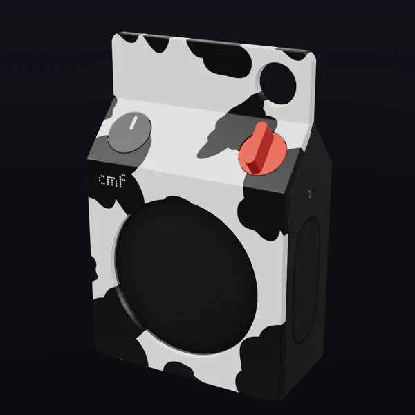
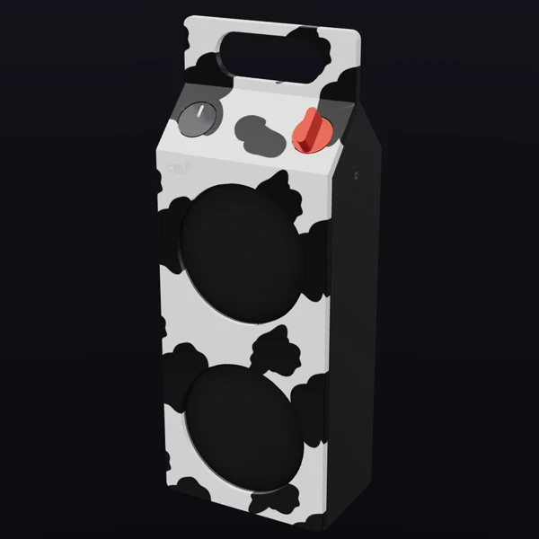
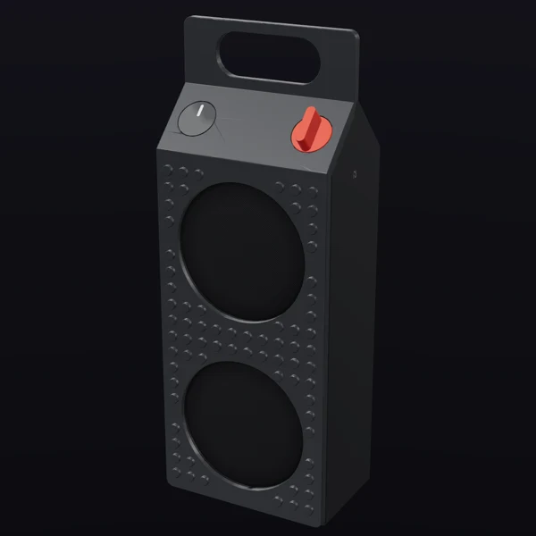
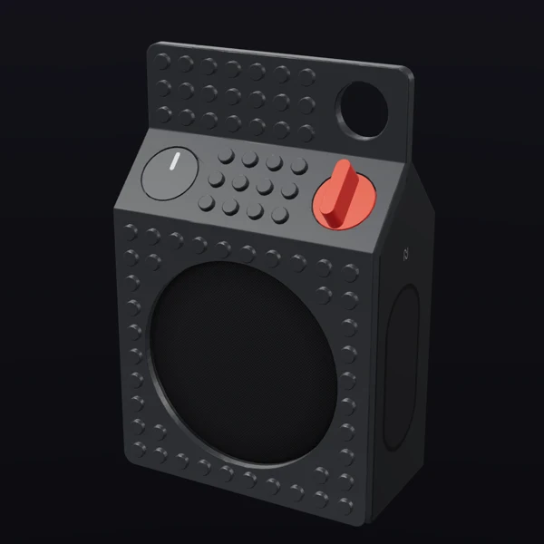
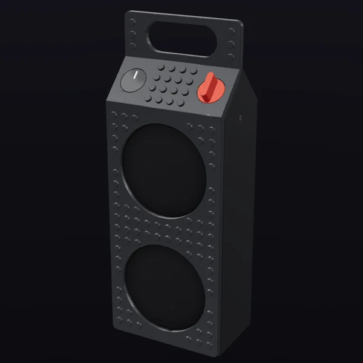
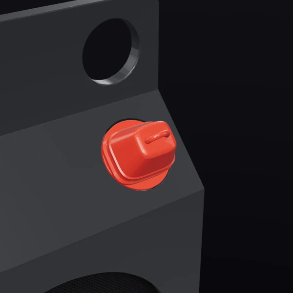
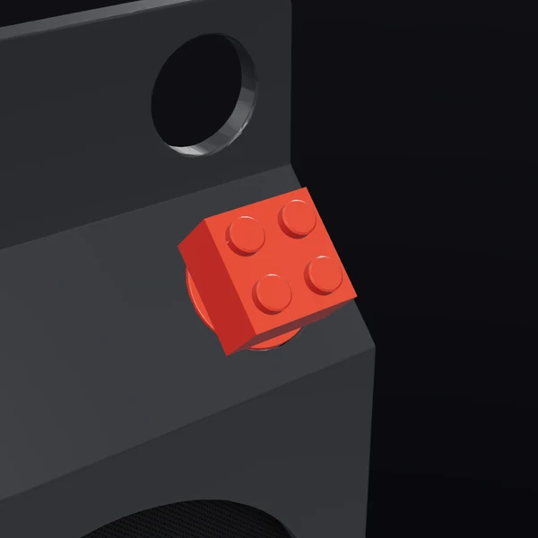

# Case Lab parts

Print files for the parts I design in [Case Lab](https://caselab.pauwma.com) for the CMF Speaker by Nothing.

> **Untested.** I haven't printed these yet. They're here so they can be downloaded from Case Lab until I've printed and checked them. Once they're tested they'll move to MakerWorld.

Downloads are in [Releases](../../releases).

| Part | Preview | Files |
| --- | --- | --- |
| Cow panel, Speaker S |  | `cow-panel-s.3mf`, or `cow-panel-s-black-spots.stl` + the official Original panel |
| Cow panel, Speaker M |  | `cow-panel-m.3mf`, or `cow-panel-m-black-spots.stl` + the official Original panel |
| Brick Studs panel, Speaker S |  | `brick-studs-s.stl` |
| Brick Studs panel, Speaker M |  | `brick-studs-m.stl` |
| Brick Studs Full panel, Speaker S |  | `brick-studs-full-s.stl` |
| Brick Studs Full panel, Speaker M |  | `brick-studs-full-m.stl` |
| Cowbell knob (S and M) |  | `cowbell-knob.stl` |
| Brick 2×2 knob (S and M) |  | `brick-2x2.stl` |

Previews are rendered in Case Lab.

## Printing

- **Cow panels:** the 3MF is Nothing's official Original panel with the spots as a second part, 0.4 mm proud of the front. Give each part its own filament (white panel, black spots). The STL of the spots is in the same coordinates as the official panel STL, so you can import both and combine them yourself.
- **Brick panels:** the official Original panel with brick studs on the front, one solid part. Print it face up like the official panel.
- **Cowbell and Brick 2×2:** fit the official knob socket. Print them standing on their base.

The panel shape comes from Nothing's official CMF Speaker 3D printing files.
